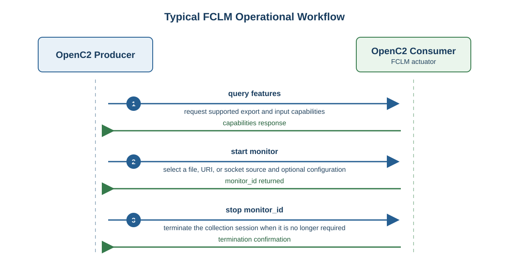

1. Overview
===========

The File Collection Log Monitoring (FCLM) profile starts and stops log
collection sessions and queries an actuator's capabilities. A session selects
one log source: a local file, a URI, or a network socket. When starting a
session, a Producer can also select log export destinations, exported fields,
and input-collection controls.

Workflow
--------

An FCLM collection session follows a flexible lifecycle; a Producer can use
only the commands required for a particular operation. The typical workflow is:

#. **Discover capabilities.** The Producer queries ``features`` to identify
   the export fields, exporter configurations, input configurations, and input
   controls supported by the Consumer.
#. **Create a monitor.** The Producer starts a ``monitor`` with the selected
   file, URI, or socket source and any compatible export or input options. The
   Consumer creates the collection session and returns a ``monitor_id``.
#. **Stop the monitor.** When collection is no longer needed, the Producer
   stops the session using its ``monitor_id``. The Consumer confirms that the
   session has terminated.

   Typical operational workflow of the FCLM actuator profile.
