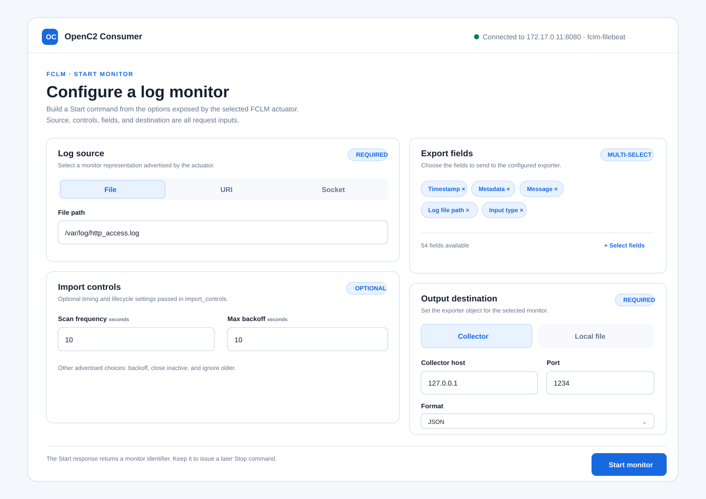

7. API Reference
================

This section describes the OpenC2-over-HTTP interface that a developer can use
to interact directly with an ``otupy`` OpenC2 Consumer. It is intended for a GUI
or command-line application that performs the FCLM lifecycle: discover the
Consumer capabilities, configure and start a log monitor, retain its identifier,
and later stop it.

The examples use the FCLM HTTP endpoint, ``POST /.well-known/openc2``. They are
illustrative rather than exhaustive. Highlighted lines in a **request** identify
values that the client supplies for an invocation. Highlighted lines in a
**response** identify values that the client should inspect or retain. The
highlighting uses Sphinx's standard emphasized-code-line style.

7.1 Query
---------

Use ``query features`` before presenting log-source, importer, exporter, and
export-field controls or issuing a ``start`` request. The response describes the
specific Consumer and FCLM actuator addressed by the request.

HTTP Request
^^^^^^^^^^^^

.. code-block:: http
   :emphasize-lines: 2,8-9,13-17,36

   POST /.well-known/openc2 HTTP/1.1
   Host: 172.17.0.11:8080
   User-Agent: python-requests/2.32.5
   Accept-Encoding: gzip, deflate
   Accept: application/openc2+json;version=1.0
   Connection: keep-alive
   Content-Type: application/openc2+json;version=1.0
   Date: Thu, 22 Oct 2026 16:21:32 
   Content-Length: 867
   
   {
      "headers": {
         "request_id": "a63f6dbb-65df-49c9-9b46-153285faf2f2",
         "created": 1792678892015,
         "from": "producer.example.net",
         "to": [
            "172.17.0.11"
         ]
      },
      "body": {
         "openc2": {
            "request": {
               "action": "query",
               "target": {
                  "features": [
                     "versions",
                     "profiles",
                     "pairs",
                     "export_fields",
                     "exports_config",
                     "import_controls",
                     "imports_config"
                  ]
               },
               "args": {
                  "response_requested": "complete"
               },
               "actuator": {
                  "x-fclm": {
                     "asset_id": "fclm-filebeat"
                  }
               }
            }
         }
      }
   }

Request Implementation Guidance
^^^^^^^^^^^^^^^^^^^^^^^^^^^^^^

HTTP Header
"""""""""""

* **Host**: obtain it from the discovery process.
* **Date**: generate it automatically.
* **Content-Length**: generate it automatically from the encoded request body.

JSON Object
"""""""""""

* ``headers.request_id``: generate a random UUID for the request.
* ``headers.created``: generate a timestamp expressed in milliseconds since
  00:00:00 UTC on 1 January 1970.
* ``headers.from``: use an identifier chosen for the GUI or CLI application.
* ``headers.to``: repeat the Consumer host IP address or name.
* ``body.openc2.request.target.features``: request the common OpenC2 features
  and the FCLM-specific capability features needed to construct a Start request.
* ``body.openc2.request.args.response_requested``: use ``complete`` to obtain
  the response only after the Command has been fully processed.
* ``body.openc2.request.actuator``: use the ``x-fclm`` namespace and the
  ``asset_id`` supplied by context discovery.

HTTP Response
^^^^^^^^^^^^^

.. code-block:: http
   :emphasize-lines: 1,20,24-94,96-112

   HTTP/1.1 200 OK
   Server: Werkzeug/3.1.6 Python/3.13.9
   Date: Thu, 22 Oct 2026 14:21:32 GMT
   Content-Type: application/openc2+json;version=1.0
   Content-Length: 3540
   Connection: close
   
   {
      "headers": {
         "request_id": "a63f6dbb-65df-49c9-9b46-153285faf2f2",
         "created": 1792678892131,
         "from": "connector@abete.tnt-lab.unige.it",
         "to": [
            "producer.example.net"
         ]
      },
      "body": {
         "openc2": {
            "response": {
               "status": 200,
               "status_text": "Features available",
               "results": {
                  "x-fclm": {
                     "export_fields": [
                        "timestamp",
                        "metadata",
                        "metadata beat",
                        "metadata type",
                        "metadata version",
                        "agent id",
                        "agent name",
                        "agent type",
                        "agent version",
                        "ecs version",
                        "host name",
                        "host hostname",
                        "host ip",
                        "host mac",
                        "host architecture",
                        "host os platform",
                        "host os version",
                        "host os family",
                        "host os name",
                        "host os kernel",
                        "host os codename",
                        "input type",
                        "log file path",
                        "log file inode",
                        "log file device id",
                        "log offset",
                        "message",
                        "event module",
                        "event dataset",
                        "event category",
                        "user name",
                        "user id",
                        "process name",
                        "process pid",
                        "network source ip",
                        "network destination ip",
                        "network source port",
                        "network destination port",
                        "network protocol",
                        "network type",
                        "network direction",
                        "network bytes sent",
                        "network bytes received",
                        "network interface name",
                        "network interface mac",
                        "network interface ip",
                        "cloud id",
                        "cloud provider",
                        "cloud region",
                        "cloud instance id",
                        "cloud machine type",
                        "cloud availability zone",
                        "cloud account id",
                        "cloud service"
                     ],
                     "exports_config": [
                        "file"
                     ],
                     "import_controls": [
                        "scan_frequency",
                        "backoff",
                        "max_backoff",
                        "close_inactive",
                        "ignore_older"
                     ],
                     "imports_config": [
                        "file",
                        "uri",
                        "socket"
                     ]
                  },
                  "versions": [
                     "1.0"
                  ],
                  "profiles": [
                     "x-fclm"
                  ],
                  "pairs": {
                     "query": [
                        "features"
                     ],
                     "start": [
                        "x-fclm:monitor"
                     ],
                     "stop": [
                        "x-fclm:monitor_id"
                     ]
                  }
               }
            }
         }
      }
   }

Response Implementation Guidance
^^^^^^^^^^^^^^^^^^^^^^^^^^^^^^^

First verify the HTTP status and ``body.openc2.response.status``. A successful
response provides the capabilities used to construct the Start request.

* **Log source**: create source controls from
  ``body.openc2.response.results.x-fclm.imports_config``. For the Filebeat
  actuator in this example, the available kinds are ``file``, ``uri``, and
  ``socket``. When serializing the FCLM target, use the profile spelling
  ``file``, ``URI``, or ``socket``, respectively.
* **Import controls** *(optional)*: create an input only for each name in
  ``body.openc2.response.results.x-fclm.import_controls``. These controls tune
  file or stream ingestion, for example scan frequency and backoff timing.
* **Export fields** *(optional)*: populate a multi-select from
  ``body.openc2.response.results.x-fclm.export_fields``. For the Filebeat
  actuator, retain a mapping from each capability label to the identifier used
  in the Start request. For example, ``log file path`` maps to
  ``log.file.path`` and ``input type`` maps to ``input.type``.
* **Exporter configuration**: use
  ``body.openc2.response.results.x-fclm.exports_config`` to show the output
  mechanisms advertised by the addressed actuator. The Start request expresses
  the choice through an ``exporter`` object; it may contain local ``storage``,
  remote ``collectors``, or both.
* **Compatibility checks**: inspect ``versions``, ``profiles``, and ``pairs``
  before enabling commands. In particular, the selected actuator must advertise
  ``x-fclm`` and the ``start`` / ``x-fclm:monitor`` and ``stop`` /
  ``x-fclm:monitor_id`` pairs.

   Example GUI layout for configuring an FCLM log monitor from a Query response.

7.2 Start
---------

Use the selections made from the Query response to construct an FCLM monitor
definition. The example monitors a log file, exports selected fields to a
Filebeat collector, and applies two optional import controls.

HTTP Request
^^^^^^^^^^^^

.. code-block:: http
   :emphasize-lines: 2,8-9,13-17,25-27,33-53,59

   POST /.well-known/openc2 HTTP/1.1
   Host: 172.17.0.11:8080
   User-Agent: python-requests/2.32.5
   Accept-Encoding: gzip, deflate
   Accept: application/openc2+json;version=1.0
   Connection: keep-alive
   Content-Type: application/openc2+json;version=1.0
   Date: Thu, 22 Oct 2026 16:21:36 
   Content-Length: 1455
   
   {
      "headers": {
         "request_id": "bea3b798-1892-4cfd-af98-5c3de49d14c6",
         "created": 1792678896134,
         "from": "producer.example.net",
         "to": [
            "172.17.0.11"
         ]
      },
      "body": {
         "openc2": {
            "request": {
               "action": "start",
               "target": {
                  "x-fclm:monitor": {
                     "file": {
                        "path": "/var/log/http_access.log"
                     }
                  }
               },
               "args": {
                  "x-fclm": {
                     "exporter": {
                        "collectors": [
                           {
                              "host": {
                                 "hostname": "127.0.0.1"
                              },
                              "port": 1234,
                              "format": "json"
                           }
                        ]
                     },
                     "import_controls": {
                        "scan_frequency": 10,
                        "max_backoff": 10
                     },
                     "export_fields": [
                        "timestamp",
                        "metadata",
                        "message",
                        "log.file.path",
                        "input.type"
                     ]
                  }
               },
               "actuator": {
                  "x-fclm": {
                     "asset_id": "fclm-filebeat"
                  }
               }
            }
         }
      }
   }

Request Implementation Guidance
^^^^^^^^^^^^^^^^^^^^^^^^^^^^^^

HTTP Header
"""""""""""

Use the same header rules as for Query: obtain **Host** from discovery and
generate **Date** and **Content-Length** automatically.

JSON Object
"""""""""""

* Use the same ``headers`` rules as Query.
* ``body.openc2.request.target.x-fclm:monitor``: construct exactly one source
  selected from the capabilities returned by Query. The example uses a ``file``
  source and its ``path``; the profile also supports ``URI`` and ``socket``
  sources when the actuator advertises them.
* ``body.openc2.request.args.x-fclm.exporter``: configure at least one output.
  The example sends logs to a collector by hostname, port, and file format; a
  local storage target can be used instead or in addition when supported.
* ``body.openc2.request.args.x-fclm.import_controls``: include only the
  controls advertised by Query, using the durations selected by the user.
* ``body.openc2.request.args.x-fclm.export_fields``: include the selected
  Filebeat field identifiers, using the display-name mapping obtained during
  configuration.
* ``body.openc2.request.actuator.x-fclm.asset_id``: repeat the value used for
  Query.

HTTP Response
^^^^^^^^^^^^^

.. code-block:: http
   :emphasize-lines: 1,20,24

   HTTP/1.1 200 OK
   Server: Werkzeug/3.1.6 Python/3.13.9
   Date: Thu, 22 Oct 2026 14:21:39 GMT
   Content-Type: application/openc2+json;version=1.0
   Content-Length: 504
   Connection: close
   
   {
      "headers": {
         "request_id": "bea3b798-1892-4cfd-af98-5c3de49d14c6",
         "created": 1792678899306,
         "from": "connector@abete.tnt-lab.unige.it",
         "to": [
            "producer.example.net"
         ]
      },
      "body": {
         "openc2": {
            "response": {
               "status": 200,
               "status_text": "Monitor started",
               "results": {
                  "x-fclm": {
                     "monitor_id": "Epsilon_9037HL"
                  }
               }
            }
         }
      }
   }

Response Implementation Guidance
^^^^^^^^^^^^^^^^^^^^^^^^^^^^^^^

* Verify status 200 in both the HTTP status line and
  ``body.openc2.response.status``.
* Save ``body.openc2.response.results.x-fclm.monitor_id``. This MonitorID value
  uniquely identifies the running FCLM monitor and is required to stop it.

7.3 Stop
--------

Use the monitor identifier saved from a successful Start response to terminate
that log-monitoring session.

HTTP Request
^^^^^^^^^^^^

.. code-block:: http
   :emphasize-lines: 2,8-9,13-17,25,33

   POST /.well-known/openc2 HTTP/1.1
   Host: 172.17.0.11:8080
   User-Agent: python-requests/2.32.5
   Accept-Encoding: gzip, deflate
   Accept: application/openc2+json;version=1.0
   Connection: keep-alive
   Content-Type: application/openc2+json;version=1.0
   Date: Thu, 22 Oct 2026 16:21:48 
   Content-Length: 643
   
   {
      "headers": {
         "request_id": "8d493455-4392-4f04-b643-7f007153dbbf",
         "created": 1792678908724,
         "from": "producer.example.net",
         "to": [
            "172.17.0.11"
         ]
      },
      "body": {
         "openc2": {
            "request": {
               "action": "stop",
               "target": {
                  "x-fclm:monitor_id": "Epsilon_9037HL"
               },
               "args": {
                  "x-fclm": {},
                  "response_requested": "complete"
               },
               "actuator": {
                  "x-fclm": {
                     "asset_id": "fclm-filebeat"
                  }
               }
            }
         }
      }
   }

Request Implementation Guidance
^^^^^^^^^^^^^^^^^^^^^^^^^^^^^^

HTTP Header
"""""""""""

Apply the same header rules as Query and Start.

JSON Object
"""""""""""

* Use the same ``headers`` rules as Query and Start.
* ``body.openc2.request.target.x-fclm:monitor_id``: use the value returned by
  Start.
* ``body.openc2.request.args.response_requested``: use ``complete`` when the
  client needs the detailed response.
* ``body.openc2.request.actuator``: use the same actuator context returned by
  discovery and used by Query and Start.

HTTP Response
^^^^^^^^^^^^^

.. code-block:: http
   :emphasize-lines: 1,20

   HTTP/1.1 200 OK
   Server: Werkzeug/3.1.6 Python/3.13.9
   Date: Thu, 22 Oct 2026 14:21:48 GMT
   Content-Type: application/openc2+json;version=1.0
   Content-Length: 374
   Connection: close
   
   {
      "headers": {
         "request_id": "8d493455-4392-4f04-b643-7f007153dbbf",
         "created": 1792678908915,
         "from": "connector@abete.tnt-lab.unige.it",
         "to": [
            "producer.example.net"
         ]
      },
      "body": {
         "openc2": {
            "response": {
               "status": 200,
               "status_text": "Process terminated"
            }
         }
      }
   }

Response Implementation Guidance
^^^^^^^^^^^^^^^^^^^^^^^^^^^^^^^

Verify status 200 in both the HTTP status line and
``body.openc2.response.status``. A successful Stop response does not return a
new identifier; the saved monitor identifier can be discarded after the
application has recorded the successful termination.

