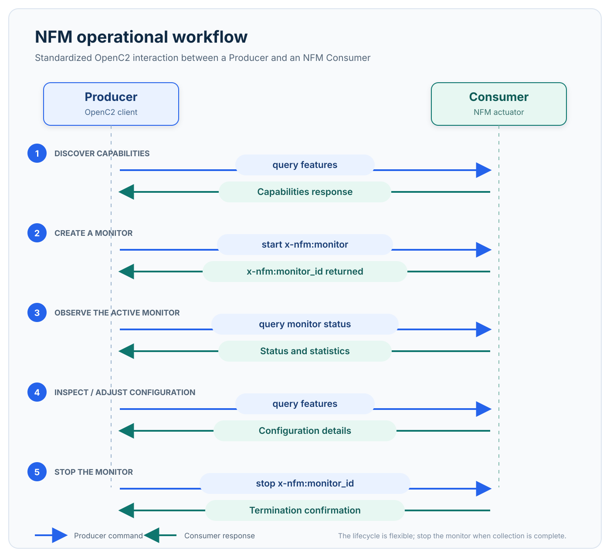

1. Overview
===========

The Netflow Monitor profile starts and stops flow-monitoring instances and
queries an actuator's capabilities. A ``start`` Command can select network
interfaces, information elements, IPv4/IPv6 connection filters, and export
behaviour for a monitoring session.

Workflow
--------

An NFM monitoring session follows a flexible lifecycle; a Producer can use only
the commands required for a particular operation. The typical workflow is:

#. **Discover capabilities.** The Producer queries ``features`` to identify the
   interfaces, information elements, exporters, and flow formats supported by
   the Consumer.
#. **Create a monitor.** The Producer starts an ``x-nfm:monitor`` with any
   required traffic filters and Command Arguments for interface selection,
   information elements, and export configuration. The Consumer creates the
   monitoring session and returns an ``x-nfm:monitor_id``.
#. **Observe the active monitor.** The Producer queries the
   ``x-nfm:monitor_id`` to obtain the monitor's status and runtime statistics.
#. **Inspect its configuration.** The Producer can query ``features`` again to
   retrieve configuration-related details, such as active filters, exporter
   settings, and interface statistics, supporting monitoring adjustment and
   tuning.
#. **Stop the monitor.** When collection is no longer needed, the Producer
   stops the session using its ``x-nfm:monitor_id``. The Consumer confirms that
   the monitor has terminated.

   Typical operational workflow of the NFM actuator profile.
