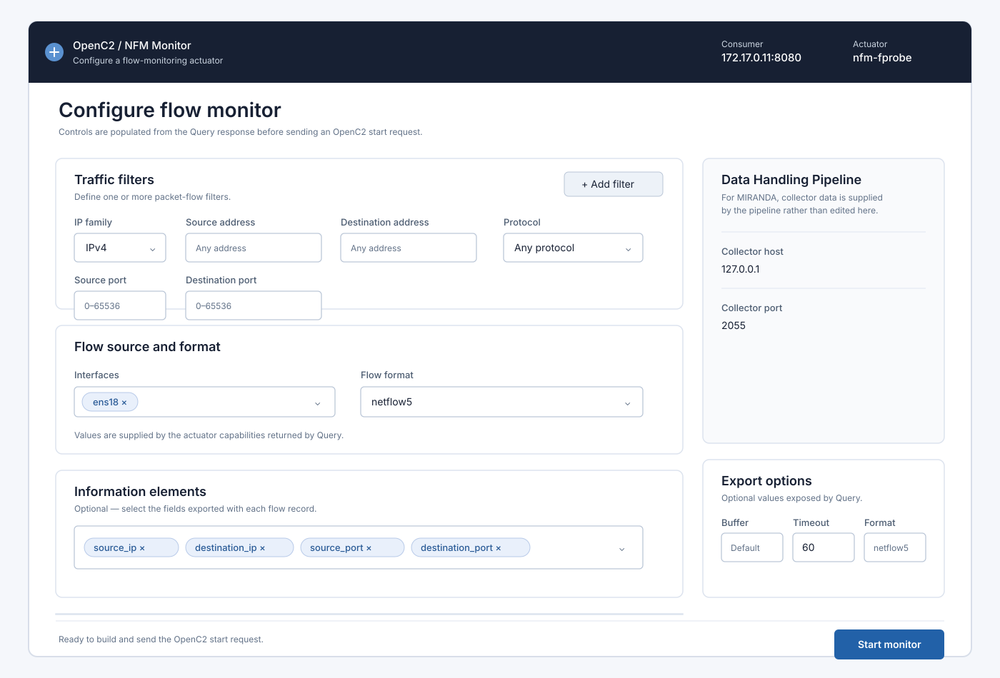

7. API Reference
================

This section describes the OpenC2-over-HTTP interface that a developer can use
to interact directly with an ``otupy`` OpenC2 Consumer. It is intended for a GUI
or command-line application that performs the NFM lifecycle: discover the
Consumer capabilities, start a monitor, and later stop it.

The examples are
illustrative rather than exhaustive. Highlighted lines in a **request** identify
values that the client supplies for an invocation. Highlighted lines in a
**response** identify values that the client should inspect or retain. 

7.1 Query
---------

Use ``query features`` before presenting monitor configuration controls or
issuing a ``start`` request. The response describes the specific Consumer and
actuator addressed by the request.

HTTP Request
^^^^^^^^^^^^

.. code-block:: http
   :emphasize-lines: 2,8,9,13-17,42

   POST /.well-known/openc2 HTTP/1.1
   Host: 172.17.0.11:8080
   User-Agent: python-requests/2.32.5
   Accept-Encoding: gzip, deflate
   Accept: application/openc2+json;version=1.0
   Connection: keep-alive
   Content-Type: application/openc2+json;version=1.0
   Date: Thu, 22 Oct 2026 14:38:38
   Content-Length: 886

   {
      "headers": {
         "request_id": "1ad563fd-2476-4bcf-bc66-8f0346dc706a",
         "created": 1792672718592,
         "from": "nfm.example.net",
         "to": [
            "172.17.0.11"
         ]
      },
      "body": {
         "openc2": {
            "request": {
               "action": "query",
               "target": {
                  "features": [
                     "versions",
                     "profiles",
                     "pairs",
                     "exports",
                     "export_options",
                     "flow_format",
                     "filters",
                     "interfaces",
                     "information_elements"
                  ]
               },
               "args": {
                  "response_requested": "complete"
               },
               "actuator": {
                  "x-nfm": {
                     "asset_id": "nfm-fprobe"
                  }
               }
            }
         }
      }
   }

Request Implementation Guidance
^^^^^^^^^^^^^^^^^^^^^^^^^^^^^^

HTTP Header
"""""""""""

* **Host**: obtain it from the discovery process.
* **Date**: generate it automatically.
* **Content-Length**: generate it automatically from the encoded request body.

JSON Object
"""""""""""

* **headers.request_id**: generate a random UUID for the request.
* **headers.created**: generate a timestamp expressed in milliseconds since
  00:00:00 UTC on 1 January 1970.
* **headers.from**: use an identifier chosen for the GUI or CLI application.
* **headers.to**: repeat the Consumer host IP address or name.
* **body.openc2.request.actuator**: use the ``x-nfm`` namespace and the
  ``asset_id`` supplied by context discovery.

HTTP Response
^^^^^^^^^^^^^

.. code-block:: http
   :emphasize-lines: 1,20,27-30,32-40,42,44,57

   HTTP/1.1 200 OK
   Server: Werkzeug/3.1.6 Python/3.13.9
   Date: Thu, 22 Oct 2026 12:38:38 GMT
   Content-Type: application/openc2+json;version=1.0
   Content-Length: 2065
   Connection: close

   {
      "headers": {
         "request_id": "1ad563fd-2476-4bcf-bc66-8f0346dc706a",
         "created": 1792672718783,
         "from": "connector@abete.tnt-lab.unige.it",
         "to": [
            "nfm.example.net"
         ]
      },
      "body": {
         "openc2": {
            "response": {
               "status": 200,
               "status_text": "Features available",
               "results": {
                  "x-nfm": {
                     "exports": [
                        "collector"
                     ],
                     "export_options": [
                        "buffer",
                        "format",
                        "timeout"
                     ],
                     "flow_format": [
                        "netflow5",
                        "netflow7"
                     ],
                     "filters": [
                        "source / destination",
                        "ipv4 / ipv6",
                        "port",
                        "protocol"
                     ],
                     "interfaces": [
                        {
                           "name": "ens18",
                           "description": "Interface ens18",
                           "ipv4_addr": [
                              "172.17.0.11"
                           ],
                           "ipv6_addr": [
                              "fe80::705d:f5ff:fee2:695b"
                           ],
                           "mac_addr": "72:5D:F5:E2:69:5B",
                           "iface_type": "ether",
                           "active": "UP"
                        }
                     ],
                     "information_elements": []
                  },
                  "versions": [
                     "1.0"
                  ],
                  "profiles": [
                     "x-nfm"
                  ],
                  "pairs": {
                     "query": [
                        "features"
                     ],
                     "start": [
                        "x-nfm:monitor"
                     ],
                     "stop": [
                        "x-nfm:monitor_id"
                     ]
                  }
               }
            }
         }
      }
   }

Response Implementation Guidance
^^^^^^^^^^^^^^^^^^^^^^^^^^^^^^^

First verify the HTTP status and ``body.openc2.response.status``. A successful
response provides the configuration data used to construct the Start request.

* **Filter**: provide one or more filter rows; a single row is sufficient for a
  demonstration. Each row has an IPv4/IPv6 selector (default IPv4), source and
  destination address ranges, source and destination ports (0--65536), and a
  protocol selector with ``icmp``, ``tcp``, ``udp``, or ``sctp``. The
  ``filters`` result records the filtering capabilities exposed by the actuator.
* **Interface**: populate a multi-select dropdown from
  ``body.openc2.response.results.x-nfm.interfaces[].name``.
* **Flow format**: populate a dropdown from
  ``body.openc2.response.results.x-nfm.flow_format``.
* **Exporter**: for MIRANDA, this control can be omitted; use the Data
  Handling Pipeline configuration instead.
* **Export options** *(optional)*: for each item in
  ``body.openc2.response.results.x-nfm.export_options``, create a text input
  labelled with that item.
* **Information elements** *(optional)*: copy the values from
  ``body.openc2.response.results.x-nfm.information_elements`` into a
  multi-select checklist or dropdown.

   Example GUI layout for configuring an NFM flow monitor from a Query response.

7.2 Start
---------

Use the selections made from the Query response to construct the NFM monitor
definition. The example uses an empty IPv4 filter, a NetFlow collector, one
network interface, and two Information Elements.

HTTP Request
^^^^^^^^^^^^

.. code-block:: http
   :emphasize-lines: 2,8,9,13-17,25-26,35,37,42-43,47,51-52,58

   POST /.well-known/openc2 HTTP/1.1
   Host: 172.17.0.11:8080
   User-Agent: python-requests/2.32.5
   Accept-Encoding: gzip, deflate
   Accept: application/openc2+json;version=1.0
   Connection: keep-alive
   Content-Type: application/openc2+json;version=1.0
   Date: Thu, 22 Oct 2026 14:38:50
   Content-Length: 1375

   {
      "headers": {
         "request_id": "bfe73434-9ad5-4a01-a22d-f37a7a8a6b45",
         "created": 1792672730514,
         "from": "nfm.example.net",
         "to": [
            "172.17.0.11"
         ]
      },
      "body": {
         "openc2": {
            "request": {
               "action": "start",
               "target": {
                  "x-nfm:monitor": {
                     "filter_v4": []
                  }
               },
               "args": {
                  "x-nfm": {
                     "exporter": {
                        "collectors": [
                           {
                              "host": {
                                 "hostname": "127.0.0.1"
                              },
                              "port": 2055
                           }
                        ]
                     },
                     "exporter_options": {
                        "timeout": 60,
                        "format": "netflow5"
                     },
                     "interfaces": [
                        {
                           "name": "ens18"
                        }
                     ],
                     "information_elements": [
                        "source ip",
                        "destination ip"
                     ]
                  }
               },
               "actuator": {
                  "x-nfm": {
                     "asset_id": "nfm-fprobe"
                  }
               }
            }
         }
      }
   }

Request Implementation Guidance
^^^^^^^^^^^^^^^^^^^^^^^^^^^^^^

HTTP Header
"""""""""""

Use the same header rules as for Query: obtain **Host** from discovery and
generate **Date** and **Content-Length** automatically.

JSON Object
"""""""""""

* Use the same ``headers`` rules as Query.
* **body.openc2.request.target.x-nfm:monitor**: set it from the Filter
  configuration.
* **body.openc2.request.args.x-nfm.exporter.collectors**: set the collector
  hostname or IP address and port from the Data Handling Pipeline
  configuration.
* **body.openc2.request.args.x-nfm.exporter_options.format**: copy the selected
  Flow format.
* **body.openc2.request.args.x-nfm.exporter_options.timeout**: use a static
  value or omit it.
* **body.openc2.request.args.x-nfm.interfaces**: set it from the selected
  interfaces.
* **body.openc2.request.args.x-nfm.information_elements**: set it from the
  selected Information Elements.
* **body.openc2.request.actuator.x-nfm.asset_id**: repeat the value used for
  Query.

HTTP Response
^^^^^^^^^^^^^

.. code-block:: http
   :emphasize-lines: 1,20,24

   HTTP/1.1 200 OK
   Server: Werkzeug/3.1.6 Python/3.13.9
   Date: Thu, 22 Oct 2026 12:38:53 GMT
   Content-Type: application/openc2+json;version=1.0
   Content-Length: 496
   Connection: close

   {
      "headers": {
         "request_id": "bfe73434-9ad5-4a01-a22d-f37a7a8a6b45",
         "created": 1792672733738,
         "from": "connector@abete.tnt-lab.unige.it",
         "to": [
            "nfm.example.net"
         ]
      },
      "body": {
         "openc2": {
            "response": {
               "status": 200,
               "status_text": "Monitor started",
               "results": {
                  "x-nfm": {
                     "monitor_id": "Sigma_5803SZ"
                  }
               }
            }
         }
      }
   }

Response Implementation Guidance
^^^^^^^^^^^^^^^^^^^^^^^^^^^^^^^

* Verify status 200 in both the HTTP status line and
  ``body.openc2.response.status``.
* Save ``body.openc2.response.results.x-nfm.monitor_id``. This
  :ref:`Monitor ID <nfm-type-monitor-id>` is required to stop the monitor.

7.3 Stop
--------

Use the monitor identifier saved from a successful Start response to terminate
that monitoring session.

HTTP Request
^^^^^^^^^^^^

.. code-block:: http
   :emphasize-lines: 2,8,9,13-17,25,32

   POST /.well-known/openc2 HTTP/1.1
   Host: 172.17.0.11:8080
   User-Agent: python-requests/2.32.5
   Accept-Encoding: gzip, deflate
   Accept: application/openc2+json;version=1.0
   Connection: keep-alive
   Content-Type: application/openc2+json;version=1.0
   Date: Thu, 22 Oct 2026 14:39:13
   Content-Length: 602

   {
      "headers": {
         "request_id": "c509f3ed-2f55-4f74-ac68-adba10913b20",
         "created": 1792672753251,
         "from": "nfm.example.net",
         "to": [
            "172.17.0.11"
         ]
      },
      "body": {
         "openc2": {
            "request": {
               "action": "stop",
               "target": {
                  "x-nfm:monitor_id": "Sigma_5803SZ"
               },
               "args": {
                  "response_requested": "complete"
               },
               "actuator": {
                  "x-nfm": {
                     "asset_id": "nfm-fprobe"
                  }
               }
            }
         }
      }
   }

Request Implementation Guidance
^^^^^^^^^^^^^^^^^^^^^^^^^^^^^^

HTTP Header
"""""""""""

Apply the same header rules as Query and Start.

JSON Object
"""""""""""

* Use the same ``headers`` rules as Query and Start.
* **body.openc2.request.target.x-nfm:monitor_id**: use the value returned by
  Start.
* **body.openc2.request.actuator**: use the same actuator context returned by
  discovery and used by Query and Start.

HTTP Response
^^^^^^^^^^^^^

.. code-block:: http
   :emphasize-lines: 1,20

   HTTP/1.1 200 OK
   Server: Werkzeug/3.1.6 Python/3.13.9
   Date: Thu, 22 Oct 2026 12:39:14 GMT
   Content-Type: application/openc2+json;version=1.0
   Content-Length: 369
   Connection: close

   {
      "headers": {
         "request_id": "c509f3ed-2f55-4f74-ac68-adba10913b20",
         "created": 1792672754775,
         "from": "connector@abete.tnt-lab.unige.it",
         "to": [
            "nfm.example.net"
         ]
      },
      "body": {
         "openc2": {
            "response": {
               "status": 200,
               "status_text": "Process terminated"
            }
         }
      }
   }

Response Implementation Guidance
^^^^^^^^^^^^^^^^^^^^^^^^^^^^^^^

Verify status 200 in both the HTTP status line and
``body.openc2.response.status``. A successful Stop response does not return a
new identifier; the saved monitor identifier can be discarded after the
application has recorded the successful termination.
