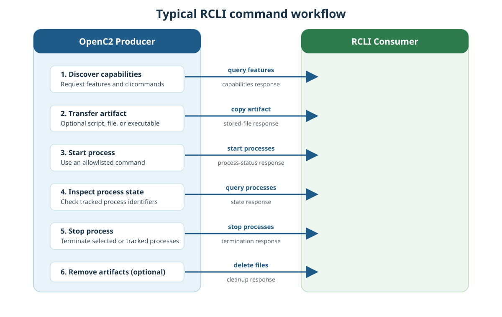

1. Overview
===========

The Remote Command-Line Interface (RCLI) profile provides a controlled OpenC2
interface for security functions that are exposed through a command-line
interface rather than through a dedicated actuator profile. It can transfer an
artifact to the Consumer, run an approved command-line program, inspect the
processes and artifacts tracked by the actuator, and remove them when they are
no longer required.

RCLI is not a general-purpose remote shell. The current implementation runs
only commands that its administrator has explicitly allowlisted, together with
their permitted flags and path arguments. A Producer should therefore discover
the actual capabilities of the addressed Consumer before requesting execution.

Workflow
--------

RCLI operations form a flexible lifecycle. A Producer uses only the operations
needed for the task; transferring an artifact and removing it afterwards are
optional.

#. **Discover capabilities.** The Producer queries ``features``, including
   ``clicommands``, to obtain the supported OpenC2 pairs and the configured
   command allowlist.
#. **Transfer an artifact (optional).** The Producer copies an ``artifact`` to
   the Consumer when a script, configuration file, or executable is required.
#. **Start a process.** The Producer starts one or more approved
   ``processes``. The Consumer returns the identifiers of the started
   processes.
#. **Inspect processes.** The Producer queries ``processes`` to retrieve the
   state of a particular tracked process or all processes available to it.
#. **Stop processes.** The Producer stops selected ``processes``, or all
   tracked processes when the target is empty.
#. **Remove artifacts (optional).** The Producer deletes previously stored
   ``files`` when they are no longer needed.

   Typical operational workflow of the RCLI actuator profile.
