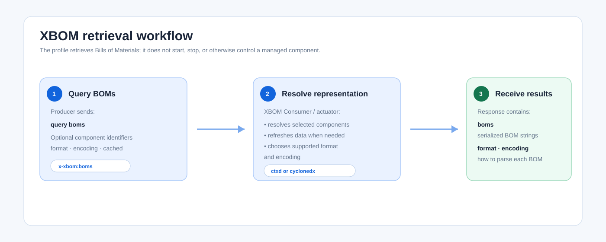

1. Overview
===========

The eXtended Bill of Materials (XBOM) profile lets an OpenC2 Producer retrieve
machine-readable descriptions of components and their dependencies from an
OpenC2 Consumer. It is a discovery profile: it uses the common ``query`` Action
rather than changing the state of an actuator.

An XBOM response contains one or more serialized Bills of Materials (BOMs).
The Producer can request a particular XBOM data model and encoding, or allow the
Consumer to use its default representation. The current implementation defines
the native ``ctxd`` representation and the ``cyclonedx`` representation, with
JSON, XML, and YAML encoding choices.

Workflow
--------

An XBOM exchange has three steps:

#. **Request BOMs.** The Producer issues ``query boms``. The target can contain
   component identifiers to narrow the request; an empty target requests all
   BOMs available through the addressed Consumer.
#. **Select the representation.** The Producer can request ``format`` and
   ``encoding`` and select whether cached information is acceptable through
   ``cached``. When ``cached`` is false or omitted, the Consumer updates its
   component information before responding.
#. **Consume the result.** The Consumer returns serialized BOM strings in
   ``boms`` and identifies the representation actually used through ``format``
   and ``encoding``.

   Typical retrieval workflow of the XBOM profile.

